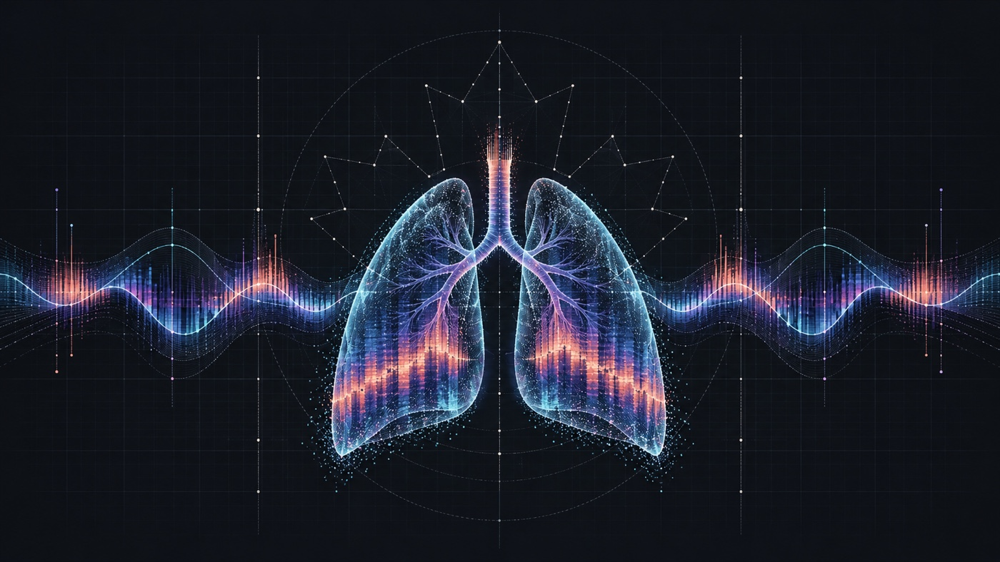
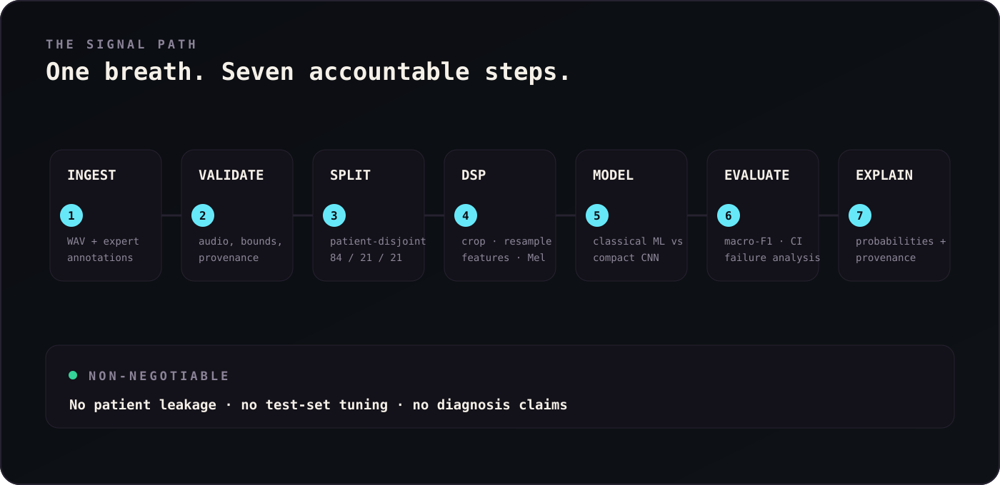
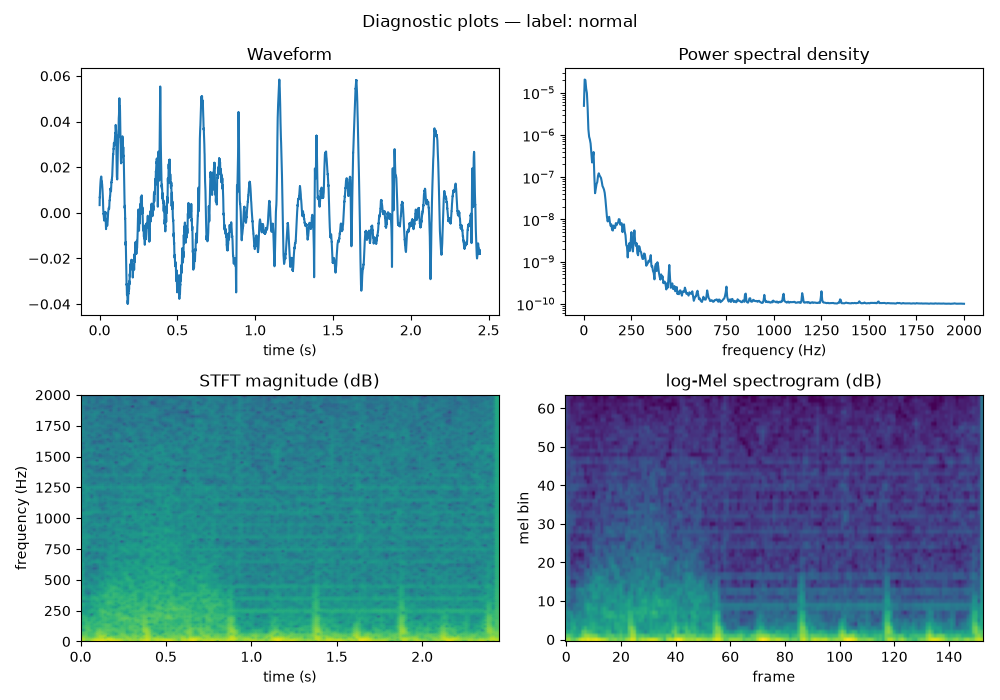
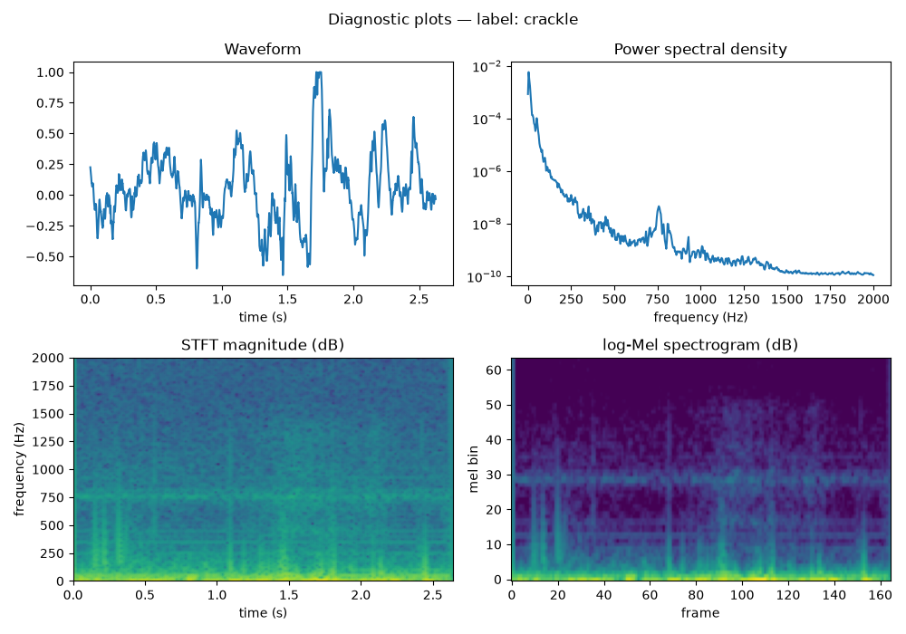
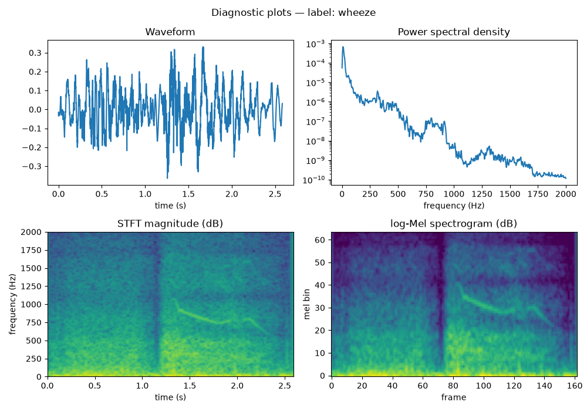
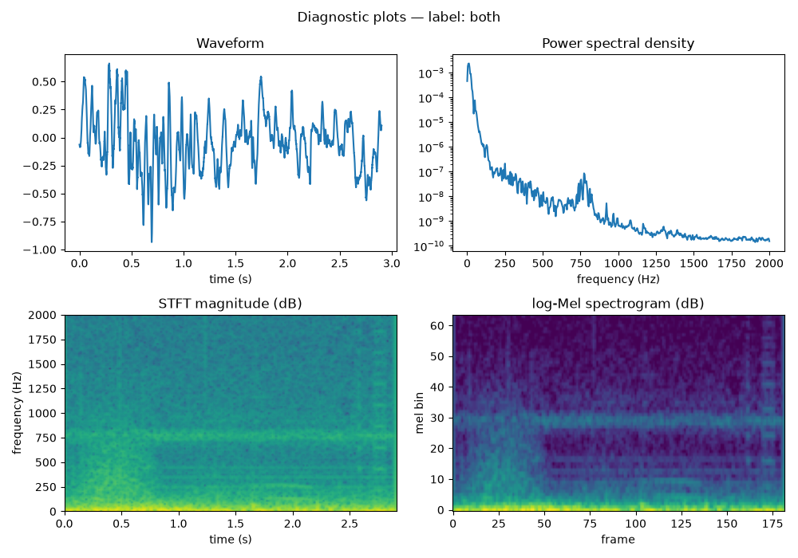
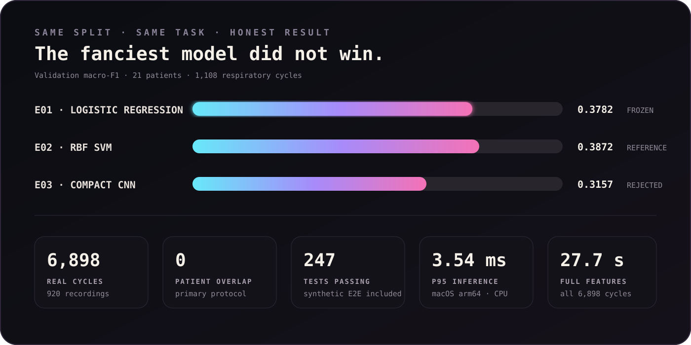

<div align="center">



# RespiraLab

### Listen deeper. Claim less.

**A reproducible respiratory sound-event lab for Normal · Crackle · Wheeze · Both**

Built for **Hack Canada 2026** 🇨🇦

[](https://www.python.org/)
[](https://pytorch.org/)
[](https://scikit-learn.org/)
[](https://streamlit.io/)
[](#proof-not-hype)
[](#v2--pretrained-audio-stricter-evidence)
[](#zero-shot-external-validation)
[](LICENSE)

> **Research only — not a diagnostic device.** RespiraLab classifies respiratory sound events. It does not detect asthma, COPD, pneumonia, or any other disease, and its output must not guide medical decisions.

</div>

---

## The signal between the breaths

A lung recording looks like one waveform. Inside it are short respiratory cycles whose time-frequency patterns can contain **crackles**, **wheezes**, both, or neither.

RespiraLab turns those cycles into a transparent, reproducible ML workflow: it validates the source audio, keeps patients isolated across data splits, extracts deterministic DSP features, compares classical ML with a compact CNN and a pretrained audio transformer, and surfaces an experimental prediction with its probabilities and provenance.

| The project does | The project deliberately does not |
|---|---|
| Classify expert-annotated respiratory cycles | Diagnose a disease or replace a clinician |
| Compare classical ML and a compact CNN | Claim deep learning wins when the evidence says otherwise |
| Audit patient leakage and dataset provenance | Tune against the locked final test set |
| Visualize waveform + log-Mel spectrogram | Upload, retain, or redistribute private audio |

## v2 — pretrained audio, stricter evidence

v2 replaces single-split model selection with **5-fold patient-grouped cross-validation** over the 105 development patients. The 21 primary-test patients remain outside every fold. Its frozen E06 model starts from [`MIT/ast-finetuned-audioset-10-10-0.4593`](https://huggingface.co/MIT/ast-finetuned-audioset-10-10-0.4593), fine-tunes only the final 2 of 12 transformer blocks plus a new classification head, and keeps the training budget bounded to at most three epochs.

| Protocol | v1 reference — E01 | v2 — E06 AST | Change |
|---|---:|---:|---:|
| 5-fold patient-grouped CV macro-F1 | 0.3654 ± 0.0330 | **0.4791 ± 0.0401** | **+31.1%** |
| Primary-test macro-F1 | 0.2861, CI [0.233, 0.316] | **0.5208, CI [0.416, 0.558]** | **+82.0%** |

The CV row is the valid like-for-like model-selection comparison. The test row is explicitly a **second exposure** of the frozen primary test after v1; it was run once after Gate G7 and never used to tune v2. Full evidence: [v2 freeze declaration](reports/v2_model_freeze.md) and [v2 test artifact](reports/v2_test_results.json).

Temperature scaling was fit only on pooled out-of-fold predictions—never on test data. It improved OOF ECE from `0.0819` to `0.0112`, but did **not** transfer cleanly:

> **Honest calibration result:** on the primary test set, temperature scaling made ECE worse, from `0.0464` to `0.0949`. The calibrated probabilities are therefore not presented as an improvement merely because calibration helped in CV.

### Zero-shot external validation

The frozen v1 and v2 models were evaluated without fine-tuning, threshold search, or temperature refitting on [HF_Lung_V1](https://gitlab.com/techsupportHF/HF_Lung_V1) (**CC BY 4.0**), a fully external adult population recorded with different devices.

| Model | External coverage | Macro-F1 | 95% CI by recording |
|---|---:|---:|---:|
| v1 E01 | 47,749 valid phases | 0.2165 | [0.211, 0.222] |
| v2 E06 AST | stratified 2,000 / 47,753 mapped phases | **0.3025** | [0.283, 0.320] |

This is intentionally a separate protocol—not another row in the ICBHI table. HF_Lung marks inhale/exhale **phases**, while ICBHI marks whole respiratory **cycles**; the external labels are also described by their provider as “not ground truth.” See the [external-validation report](reports/external_validation.md) and [numeric artifact](reports/external_validation.json).

The protocol changes were recorded before their results existed:

- [ADR-0001 — pretrained encoder, grouped CV, calibration, and external-validation policy](docs/adr/0001-v2-pretrained-encoder-and-evaluation.md)
- [ADR-0002 — HF_Lung breath-phase label mapping and exclusions](docs/adr/0002-external-label-mapping.md)

## v1 pipeline — from `.wav` to an honest answer



The scientific invariant is simple: **a patient belongs to exactly one split**. Preprocessing statistics are fit on training data only, augmentation stays in training, model selection uses validation, and the primary test set was opened once after the configuration was frozen.

```text
source WAV + annotation
        ↓
validate → patient-level split → cycle crop → 4 kHz resample
        ↓
handcrafted DSP features ──────┬────── log-Mel tensors
        ↓                      ↓
balanced logistic regression  compact CNN
        └──────────────┬───────┘
                       ↓
macro-F1 + ICBHI Score + patient bootstrap + error analysis
```

## See the breath

These are real analysis figures generated by the repository's DSP pipeline from one representative ICBHI respiratory cycle per class—not mockups.

<table>
  <tr>
    <td align="center"><br/><sub>NORMAL · quiet baseline</sub></td>
    <td align="center"><br/><sub>CRACKLE · short broadband transients</sub></td>
  </tr>
  <tr>
    <td align="center"><br/><sub>WHEEZE · sustained tonal energy</sub></td>
    <td align="center"><br/><sub>BOTH · the hardest minority class</sub></td>
  </tr>
</table>

## Proof, not hype



This table is the frozen **v1-only** comparison; v2 results stay separate above because they use grouped CV. All v1 model comparisons below use the same **patient-disjoint validation split**: 21 patients, 1,108 cycles, split hash `38e11a7f…`.

| Experiment | Model | Validation macro-F1 | ICBHI Score | `both` recall | Decision |
|---|---|---:|---:|---:|---|
| E01 | Balanced logistic regression | 0.3782 | 0.4656 | 0.0441 | **Frozen model** |
| E02 | RBF SVM | **0.3872** | 0.4763 | **0.1471** | Retained as reference; val-selected over 9 configs |
| E03 | Compact CNN | 0.3157 | **0.5083** | 0.0000 | Rejected: weaker macro-F1 and minority recall |

Why freeze E01 instead of the numerically higher E02? Their 0.009 macro-F1 gap sits well inside the patient-bootstrap uncertainty, while E02 carries selection bias from choosing the best of nine configurations on the same validation set. E01 is simpler, interpretable, and statistically indistinguishable here.

The frozen E01 model's **one-time primary test** result is macro-F1 **0.2861** and ICBHI Score **0.3762** across 1,141 cycles from 21 untouched patients. The lower test score is reported as-is; no post-test tuning followed. See the [model card](reports/model_card.md) and [final test artifact](reports/final_test_results.json).

> A useful failure taught us more than a flattering score: ICBHI Score can reward Normal specificity while hiding minority-class collapse. RespiraLab therefore treats it as supplementary to macro-F1 and per-class recall.

## Run the lab

### 1. Install

Requirements: Python `3.11` and [`uv`](https://docs.astral.sh/uv/).

```bash
git clone https://github.com/Bruce1508/respiralab.git
cd respiralab
uv sync
```

### 2. Verify the environment

```bash
uv run ruff check src tests
uv run pytest -q
uv run respiralab --version
```

Expected repository state at this milestone: `236 passed` with the local real-data cache. On a fresh clone without that cache, the same suite reports `235 passed, 1 skipped`; Ruff remains clean.

### 3. Launch the local demo

```bash
uv run streamlit run src/respiralab/app/streamlit_app.py
```

The demo accepts a mono PCM WAV up to 20 MB, renders its waveform and log-Mel spectrogram, and shows the four-class probability distribution. Add cycle bounds for `annotated_cycle` mode; without trusted bounds, the UI labels the result `exploratory_window` so it cannot be mistaken for benchmark-equivalent analysis.

> The frozen predictor is reconstructed from the user-generated feature cache. Follow the data workflow below before expecting real ICBHI inference from a fresh clone.

## Bring your own data—responsibly

The ICBHI 2017 audio is **not included**. The official page says the database is freely available for research, but no explicit redistribution grant was found, so RespiraLab ships only code, manifests, aggregate reports, and non-identifying figures.

1. Obtain the database from the [official ICBHI challenge host](https://bhichallenge.med.auth.gr/node/50).
2. Read [source-notes.md](source-notes.md) for provenance, observed archive contents, and licensing stance.
3. Keep raw recordings under `data/raw/`—the directory is gitignored.
4. Rebuild derived features locally; never commit raw audio, private metadata, or the feature cache.

Verified local audit: **126 patients · 920 recordings · 6,898 annotated cycles · 4 acquisition devices · 4/10/44.1 kHz source rates**.

## What lives where

```text
respiralab/
├── configs/                  # frozen search + CNN training configuration
├── manifests/                # inventory, cycles, feature schema, patient split
├── reports/                  # audits, experiments, model card, robustness
│   └── figures/              # real DSP and EDA visualizations
├── results/                  # reproducible experiment metadata + checkpoints
├── src/respiralab/
│   ├── data/                 # ingest, annotation parsing, split + leakage audit
│   ├── dsp/                  # resampling, filters, segmentation, features
│   ├── models/               # baselines, SVM, compact CNN, training
│   ├── evaluation/           # macro metrics, ICBHI score, patient bootstrap
│   ├── inference/            # guarded offline predictor
│   └── app/                  # Streamlit research demo
└── tests/                    # unit, DSP, model, inference, integration
```

## Guardrails that ship with the code

- **Patient-disjoint primary protocol:** 84 train / 21 validation / 21 test patients.
- **Leakage control:** split before derived cycles; train-only scaling and augmentation.
- **Trust-boundary validation:** corrupt, silent, stereo, non-finite, oversized, and invalid-rate WAVs are rejected with descriptive errors.
- **Probability correctness:** scikit-learn's alphabetical `classes_` order is explicitly remapped to the repository's canonical label order.
- **Reproducibility:** deterministic feature hashes, pinned lockfile, saved seeds/configs/commits, and synthetic end-to-end smoke tests.
- **Privacy:** uploads stay in memory; real audio and feature caches remain local and gitignored.

## Known limits

This is a research prototype, and the rough edges are part of the result:

### v1.0

- The `both` class remains difficult across every tested model.
- Test macro-F1 is lower than validation macro-F1, showing a real generalization gap.
- Macro-F1 degrades at every tested noise level, with the worst change `−0.0934` at 0 dB SNR.
- `19.2%` of source recordings contain measurable clipping.
- Consumer microphones, unseen populations, and acquisition protocols require fresh validation.
- Whole-recording analysis without expert cycle boundaries is exploratory, not equivalent to the benchmark task.

### v2 and external validation

- The v2 primary-test result is a second exposure after v1's D29 evaluation, not a fully unbiased first look; grouped CV and external validation carry more evidential weight.
- OOF temperature calibration improved CV ECE but worsened test ECE (`0.0464 → 0.0949`).
- HF_Lung's breath-phase unit does not match ICBHI's whole-cycle unit, so their absolute scores are not directly comparable.
- E06 external evaluation covers a stratified sample of 2,000 out of 47,753 mapped phases because full AST inference was compute-bounded; v1's cheaper E01 baseline covered 47,749 valid phases.
- HF_Lung uses a different adult population and device mix, and its provider explicitly says its labels are not ground truth.
- External crackle recall is only `0.055` for v2, while the sampled `both` class has just 15 examples—neither weakness is hidden behind the aggregate score.

Read the full [model card](reports/model_card.md), [robustness study](reports/robustness.md), [error analysis](reports/error_analysis.md), [performance benchmark](reports/performance.md), and [v2 external-validation report](reports/external_validation.md).

## Project status

**v1.0 is complete** through D42: reproducible core, frozen evaluation, offline inference, Streamlit UI, CI, performance benchmark, technical report, and fresh-clone walkthrough all passed Gates G1–G6. See [`demo_script.md`](demo_script.md) and [`release_notes_v1.0.md`](release_notes_v1.0.md).

**v2 is in progress** across D43–D57. The pretrained encoder, grouped-CV experiments, frozen E06 model, second primary-test evaluation, and HF_Lung audit are complete through D54. The D55 zero-shot run and report have been produced locally and await task closure; hash-verified v2 serving (D56) and the v2 release gate/documentation pass (D57) remain.

<div align="center">

### Built with curiosity, measured with restraint.

If this project helps your research or review, consider leaving a ⭐ and—more importantly—read the limitations before reading the score.

**Hack Canada 2026 · Canada**

</div>

## Acknowledgements

- The [ICBHI 2017 Respiratory Sound Database](https://bhichallenge.med.auth.gr/node/50) and its original contributors.
- The open-source communities behind NumPy, SciPy, librosa, scikit-learn, PyTorch, Matplotlib, Streamlit, pytest, and Ruff.

## License

Project code is available under the [MIT License](LICENSE). The ICBHI dataset is governed separately by its source terms and is not redistributed here.
