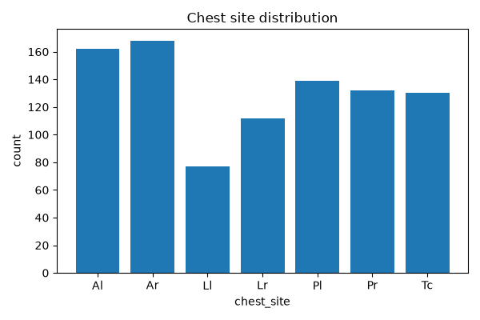
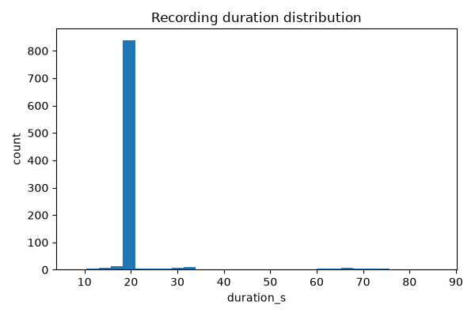

# Data audit report (D05)

Generated from `manifests/dataset_inventory.csv` (920 recordings) and
`manifests/cycles.csv` (6898 cycles).

## Cross-check against official totals
No discrepancies — all counts match the official ICBHI totals.

## Cycle label distribution (4-class)
| label4 | count |
|---|---|
| both | 506 |
| crackle | 1864 |
| normal | 3642 |
| wheeze | 886 |

## Device distribution (recording-level)
| device | count |
|---|---|
| AKGC417L | 646 |
| Litt3200 | 60 |
| LittC2SE | 87 |
| Meditron | 127 |

## Chest site distribution (recording-level)
| chest_site | count |
|---|---|
| Al | 162 |
| Ar | 168 |
| Ll | 77 |
| Lr | 112 |
| Pl | 139 |
| Pr | 132 |
| Tc | 130 |

## Sample rate distribution (recording-level)
| sample_rate | count |
|---|---|
| 10000 | 6 |
| 4000 | 90 |
| 44100 | 824 |

## Duration statistics (seconds, recording-level)
| stat | value |
|---|---|
| min | 7.86 |
| max | 86.20 |
| mean | 21.49 |
| median | 20.00 |

## Figures

## Unique patients
126 unique patient IDs.
