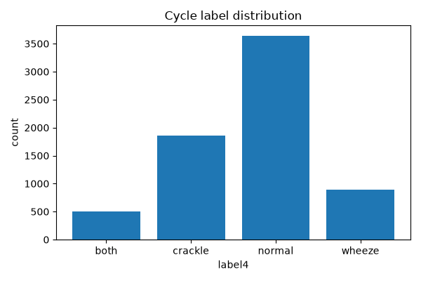
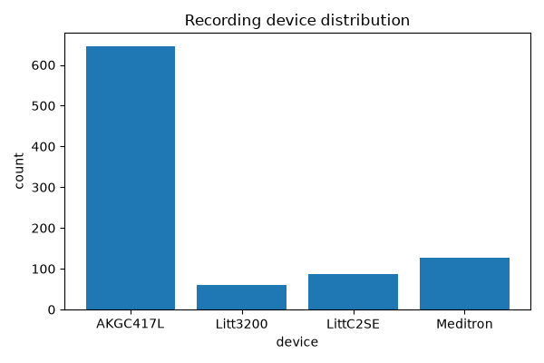
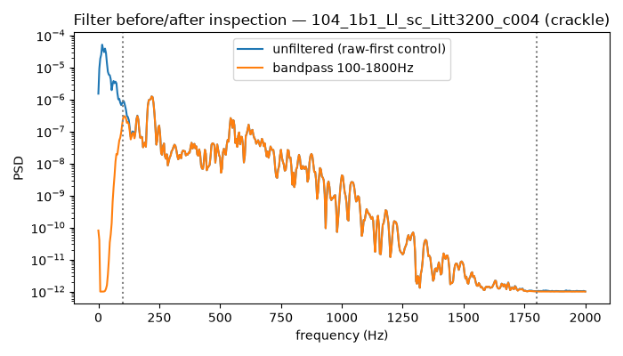

# RespiraLab — Final technical report

**Research/educational demonstration. Not a diagnostic device.** Sound-event
labels (Normal/Crackle/Wheeze/Both), not disease diagnoses. Full detail and
citations for every number below live in the per-day `reports/*.md` and
`planning/PROGRESS_LOG.md` files this report summarizes — nothing here is
restated from memory.

## Dataset and split

ICBHI 2017: 920 recordings, 126 patients, 6,898 cycles (D03/D04, exact
match to official totals). Primary split (D07): patient-disjoint,
train=84p/4649c, val=21p/1108c, test=21p/1141c, `split_hash=38e11a7f...`,
zero patient overlap (independently re-verified). The official ICBHI
challenge split is a **separate, non-disjoint protocol** — patients 156
and 218 appear in both its train and test (D06, re-confirmed D30) —
reported separately, never combined with the primary split's numbers.

*Figure 1 — cycle count per class across the full dataset (D05): heavily
imbalanced toward Normal, with `both` the rarest class.*

*Figure 2 — recording device distribution (D05): 4 heterogeneous
acquisition devices, a known confound discussed in the model card.*

## Pipeline (DSP, Gate G2 PASS at D14)

Deterministic cycle extraction → Nyquist-safe resampling → optional
filters → handcrafted features (MFCC/spectral/46-dim, D12) and log-Mel
tensors (D22, for the CNN path). 19.2% of recordings have measurable
clipping (D14) — a known data-quality limitation, not corrected.

*Figure 3 — bandpass filter effect on a real crackle cycle (D11):
in-band energy retained 0.886, out-of-band near zero.*

## Models (Gate G3 PASS at D21, Gate G4 PASS at D28)

Four candidates compared honestly: majority/stratified dummy (E00, D15),
logistic regression (E01, D16), RBF SVM (E02, D17), compact CNN (E03,
D23-D26). **E01 was frozen** (`reports/model_freeze.md`): E02's small
macro-F1 edge was inside both models' patient-bootstrap CI and carried
val-set selection bias (D21); the CNN underperformed on every metric and
failed completely on `both` (recall=0.0, D27).

## Results

| protocol | macro_f1 | icbhi_score | source |
|---|---:|---:|---|
| val (dev) | 0.3782 | 0.4656 | `results/E01/dev_scores.json` |
| **primary test (one-time, D29)** | **0.2861** | **0.3762** | `reports/final_test_results.json` |
| official split (separate, non-disjoint, D30) | 0.3366 | — | `reports/official_protocol_comparison.md` |

The test macro-F1 is honestly lower than val — a real generalization gap,
not adjusted after the fact. The primary test was opened exactly once
(D29) and is now closed; no subsequent tuning occurred.

## Robustness and error analysis

- **Noise (D31):** macro-F1 degrades at every tested SNR vs clean (worst
  -0.0934 at 0dB). Supported-use claim narrowed to ICBHI-comparable
  recording conditions.
- **Errors (D32):** of 144 misclassified wheeze/both test cycles, errors
  cluster into two non-random types — missed-abnormal-to-Normal, and
  confusion between adjacent abnormal classes.
- **Ablation (D33):** removing `class_weight="balanced"` barely moves
  macro-F1 (within the bootstrap CI) but zeroes `both`-class recall —
  a real effect the headline metric alone would hide.

## Reproducibility

Every result above cites a commit (full history in `git log` on
https://github.com/Bruce1508/respiralab), a fixed seed, and the exact
split/preprocess hash. `uv sync && uv run pytest -q` reproduces 170
passing tests from a fresh clone with no ICBHI data present (D38/D39
synthetic smoke test + CI). Real-data numbers require the user's own
ICBHI download (`data/README.md`) — raw audio is never committed.

## Limitations (full list: `reports/model_card.md`)

`both`-class recall weak across every model tried; 19.2% recording
clipping; noise sensitivity; ICBHI Score's Normal-specificity blind spot;
dataset scope limited to 126 patients / 4 devices. No diagnosis claim is
made anywhere in this pipeline.

---

## v2: pretrained encoder, calibration, external validation (D43-D57)

Per `docs/adr/0001-v2-pretrained-encoder-and-evaluation.md` (D43): keep the
same split, sound-event-only claim, and test-exposure discipline as v1;
change only the model. **Still not a diagnostic device.**

### Model selection (CV only, test never touched)

A pretrained AST encoder (`MIT/ast-finetuned-audioset-10-10-0.4593`,
AudioSet-pretrained) replaces the handcrafted-feature pipeline. Three
single-factor comparisons, all decided on grouped 5-fold CV:

| experiment | change | result | decision |
|---|---|---:|---|
| E05 (D47) | frozen encoder embeddings → logistic regression | macro_f1=0.4448±0.0226 | beats E01's CV reference (0.3654±0.0330) |
| E06 (D49) | + bounded fine-tune, last 2 blocks | macro_f1=0.4791±0.0401 | clears E05's mean+1sd bar — **chosen for v2** |
| E07 (D50) | balanced_sampling on E05's embeddings | both_recall=0.3683±0.1067 vs ref 0.2634±0.1516 | wins on minority class, **not fused in** (single-factor discipline) |
| E08 (D51) | repeat-pad vs zero-pad | macro_f1=0.4243±0.0298 (repeat) vs 0.4448±0.0226 (zero) | zero-pad confirmed correct, no change |

### Freeze and calibration (Gate G7 PASS, D52)

E06 retrained on 100% of train+val (5,757 cycles, `final_epochs=2`), OOF
temperature fit on the same 5-fold split (temperature=1.3288,
ECE 0.0819→0.0112 on the OOF set itself). Weights hashed
(`e3ddc62d...`) before any primary-test exposure.

### Second exposure of the primary test (one-time, D53)

| protocol | model | macro_f1 | 95% CI |
|---|---|---:|---:|
| primary test | E01 (refit reference) | 0.2861 | [0.233, 0.316] |
| **primary test** | **v2 (E06)** | **0.5208** | **[0.416, 0.558]** |

v2 clears E01 comfortably and sits consistent with its own CV estimate.
**Anomaly disclosed, not hidden:** v2's OOF-fit temperature *increases*
test ECE (0.046→0.095), the opposite of E01's expected direction
(0.127→0.049) — flagged as a v2.1 investigation, not used to justify any
v2 design change (ADR-0001 D4's rule).

### External zero-shot validation (D54/D55, headline generalization evidence)

HF_Lung_V1 (CC BY 4.0, adult population, different devices entirely —
`docs/adr/0002-external-label-mapping.md`). **Separate protocol table,
never merged with the ICBHI rows above** — different unit of analysis
(breath phase, not whole cycle):

| model | macro_f1 | n evaluated | notes |
|---|---:|---:|---|
| E01 | 0.2165 | 47,749 (full corpus) | |
| v2 | 0.3025 | 2,000 (stratified sample, seed 42) | full-corpus run estimated ~12h, sample used as a cost tradeoff |

Both models drop sharply under real distribution shift versus their ICBHI
numbers — expected for genuine external validation, not a regression. v2
still beats E01. **Weak point disclosed:** v2's external crackle recall is
only 0.055 (vs E01's 0.139 on the same data) despite winning overall.

### Serving (D56, Gate G7/G8)

Weights too large for git (328.86MB > GitHub's 100MB limit) — hosted on
Hugging Face Hub (`bruce1508/respiralab-v2`), downloaded and sha256-verified
before load; a mismatch is a hard refusal, never a silent fallback. A
Mahalanobis OOD gate, fit on the same 5,757 train+val cycles
(threshold=42.136 at p99), rejects off-distribution input instead of
predicting on it — verified against both a real ICBHI cycle (accepted) and
a synthetic tone (correctly rejected).

### Reproducibility (v2)

`uv sync && uv run pytest -q` passes 247/247 on a fresh clone with no
ICBHI data, HF_Lung data, or Hugging Face credentials present — all
v2-serving tests (OOD gate, hash verification, rejection paths) are
synthetic/mocked. Real-data numbers above require the user's own ICBHI
and HF_Lung downloads plus a Hugging Face Hub network path; v2's weights
are never committed to git (hash-verified external artifact per
ADR-0001 D7).

### Limitations specific to v2 (full list: `reports/model_card.md`)

Calibration regression on test (disclosed, not resolved); weak external
crackle recall; v2.1 candidates not yet pursued (balanced_sampling fusion,
noise/error-analysis studies repeated against v2). All of v1's limitations
above still apply where unchanged.
